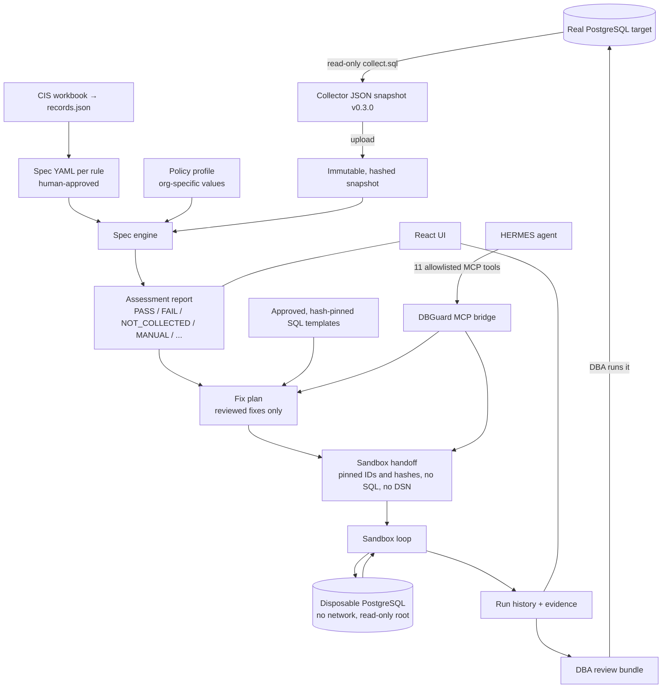
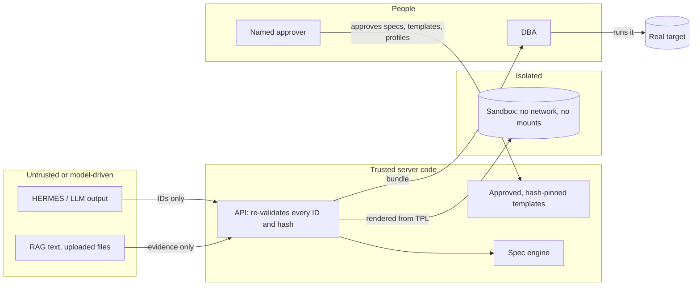

# DBGuardAI architecture

_Last reviewed against the code: 11 Nov 2026 (branch `melvin/e2e-fix-all`, after PR #44)._
For what is planned and what is done, see [docs/ROADMAP.md](docs/ROADMAP.md). For how many of the
72 CIS rules are covered today, see [docs/COVERAGE.md](docs/COVERAGE.md) (generated, always current).

## What the application does

DBGuardAI helps a database analyst check a PostgreSQL server against the CIS PostgreSQL 17
Benchmark (v1.1.0, 72 rules) and turn a failed rule into a fix the DBA can trust:

1. **Collect.** A read-only script gathers the server's settings, roles and permissions.
2. **Assess.** Each CIS rule, written down as a reviewed *spec*, is checked against that evidence.
3. **Plan.** For a failed rule, DBGuard picks a fix from a short list of reviewed fixes.
4. **Prove.** The fix is tested on a throwaway copy of the database: show the rule fails, apply the
   fix, show it passes, undo it, show the original state is back.
5. **Hand over.** The DBA gets a bundle with the fix, the evidence and screenshots, and runs it themselves.

DBGuard never changes a real database. AI (HERMES) helps explain and drive the workflow, but it never
writes SQL, never approves anything and never sees passwords.

## The big picture



The left-to-right path never writes to the target. The only arrow back to the target is the DBA
running the exported bundle.

## Building blocks

### 1. Collector (`collector/`)

- `collect.sql` (wrapped by `dbguard-collect.sh`) runs read-only queries and prints one JSON
  snapshot, schema `0.3.0` (`catalog/specs/contracts/snapshot-v0.3.0.json`).
- It pins `search_path` and `standard_conforming_strings`, reads metadata only (no table rows) and
  never ships secret-bearing setting text; such values are replaced with a redaction marker that the
  engine never evaluates.
- **Empty versus unknown:** `[]` means "checked and found nothing". `null` plus a `gaps` entry means
  "could not check". These are never treated as the same, and unknown evidence never becomes PASS.
- Only the main session changes `collect.sql`, after db-security-reviewer and Melvin approve.

### 2. Rules: benchmark, specs and policy profiles (`catalog/`)

| Path | What it holds |
| --- | --- |
| `benchmarks/cis-pg17-v1.1.0/records.json` | All 72 recommendations parsed from the CIS workbook |
| `specs/cis-pg17-v1.1.0/*.yaml` | One spec per implemented rule: what evidence to read, which operator, what counts as a pass |
| `specs/schema.json`, `specs/contracts/` | Spec schema and JSON contracts: snapshot, assessment report, check manifest, fix unit (v1, v2), sandbox handoff |
| `policies/cis-pg17-v1.1.0/reference.yaml` | Reference policy profile for rules where the right value is an organisation decision (family F3) |
| `controls/assess/` | Assessment registry: CIS controls generated from the specs, plus two `DBGUARD-*` checks |
| `images/sandbox/pg17-pgaudit.json` | The pinned sandbox image (PostgreSQL 17 + pgaudit), checked by image ID per platform |

Specs are the single source of truth. Each one is traceable: `pass_condition_quote` must be the
verbatim CIS audit text, and `scripts/validate_specs.py` enforces this. An agent may draft a spec
(`authored_by: agent`), but only a named human can approve one. Specs can say when a rule applies
(`applies_when`, giving NOT_APPLICABLE, such as syslog rules when syslog is off) and carry
interpretation notes where the CIS wording needs a human ruling.

### 3. Spec engine (`backend/app/services/spec_engine/`)

| Module | Job |
| --- | --- |
| `specs.py`, `validate.py`, `records.py` | Load specs, validate them against the schema and the CIS records |
| `operators.py` | Comparison operators: equals, in, severity order, contains tokens, mode limit, cipher subset and more |
| `assess.py` | Turn a snapshot into an assessment report, one finding per rule |
| `catalog_checks.py` | Role, privilege and object checks (F6 and others) run against snapshot catalog data |
| `policy.py` | Apply an approved policy profile to organisation-specific rules |
| `redaction.py` | Make sure redacted or secret values are never evaluated or shown |
| `manifest.py`, `sources.py` | Build the check manifest and track where each piece of evidence came from |

Finding statuses (`assessment-report-v1.json`): `PASS`, `FAIL`, `NOT_COLLECTED` (evidence missing,
also called "gapped"), `NOT_APPLICABLE`, `MANUAL` (a person must check), `NEEDS_CAPABILITY`,
`STALE` and `ERROR`. Session-level overrides of a setting never count as a PASS.

### 4. Fix planning (`services/sandbox_poc/planning.py`, `object_fixes.py`, `catalog_fixes.py`)

- **Setting fixes:** `POLICIES` in `planning.py` is the allowlist of settings DBGuard may fix. Each
  entry has a fix value, risk, impact and checks. Values are checked again by
  `backend/app/services/setting_values.py`. Fix types are `ALTER SYSTEM` + reload, `ALTER SYSTEM` +
  restart, and `shared_preload_libraries` via the separate `set_config_list` template only.
- **Per-object fixes (F6):** six fix types (`role_connection_limit`, `role_drop_attribute`,
  `role_nologin`, `function_security_invoker`, `function_revoke_public_execute`, `table_revoke_dml`).
  The DBA picks one account, function or table. Fix IDs are derived on the server from a hash of the
  target and are never chosen by a client. DBGuard never applies blanket F6 fixes.
- **Templates:** `backend/app/templates/*.sql.j2`. SQL is only ever rendered from approved,
  hash-pinned templates, and identifiers go through the `ident` filter. The handoff accepts only
  template names matching the reviewed allowlist in `handoff.py`.
- `GET /api/v1/snapshots/{id}/fix-plan` returns the plan with risk and impact for the UI and HERMES.

### 5. Sandbox handoff and loop (`services/sandbox_poc/`)

```mermaid
sequenceDiagram
    participant C as Caller (UI or HERMES via MCP)
    participant A as Sandbox API
    participant L as Remediation loop
    participant S as Disposable PostgreSQL
    C->>A: POST /sandbox/handoffs (snapshot, template version, evidence IDs, control)
    A->>A: Re-check every ID and hash; no SQL, DSN or approval accepted
    C->>A: POST /sandbox/handoffs/{id}/run
    A->>L: Start the run
    L->>S: Start a container (run-labelled, pinned image)
    L->>S: Rebuild the target's relevant state from the snapshot
    L->>L: Assess → rule must FAIL (reproduce)
    L->>S: Apply the rendered, approved fix
    L->>L: Re-assess → rule must PASS, no other rule worse, server healthy
    L->>S: Roll back
    L->>L: Re-assess → original state is back
    L->>S: Remove the container
    L-->>A: VERIFIED / NEEDS_REVIEW / FAILED + evidence
```

- **`handoff.py`** defines the versioned handoff contract: pinned hashes and IDs only.
- **`workflow.py`** holds the LangGraph loops. `RemediationLoop` handles settings and
  `ObjectRemediationLoop` handles per-object fixes, with a bounded retry.
- **`adaptive.py`** handles adaptive retry. After a failed attempt, an LLM may pick *another already
  approved candidate* or ask for human review. Its output is a strict schema (`retry` or
  `manual_review`, a candidate ID, text). It never supplies SQL, a DSN or a new template, and it sees
  scoped outcomes rather than the raw snapshot.
- **`provenance.py`** rebuilds the target's relevant settings inside the sandbox so the FAIL is
  reproduced honestly.
- **`batch.py`** tests several fixes together (`POST /api/v1/sandbox/batches`) so combined changes
  are proven too.
- **`runtime.py`** (`DisposablePostgres`) starts each sandbox with `--network none`,
  `--read-only`, `--cap-drop ALL`, `no-new-privileges`, a non-root user, memory, CPU and PID limits,
  and tmpfs-only data. Every container carries a run label and is removed afterwards. The sandbox
  accepts no DSN, host mount, network, existing container ID or raw SQL. The image is refused unless
  its local ID matches the pinned record.
- **`history.py`** keeps a local SQLite store of runs, results, handoffs and bundles
  (`DBGUARD_HISTORY_DIR`, file mode 0600). Notes added by operators never mark anything as verified.

### 6. Evidence and the DBA bundle

- **Screenshots (Task 2).** There are two modes:
  - *rendered*: `evidence_capture.py`, using Playwright.
  - *terminal*: `terminal_capture.py`, which records a real terminal with VHS on the host.

  Each mode captures before, after-fix and after-undo images. They are hashed with sha256 and stored
  with the run. Since 10 Nov, the demo takes no screenshots inside the sandbox by default (set
  `DBGUARD_SCREENSHOTS=true` to turn them on). Screenshots are planned to move to the DBA package.
- **Review bundle** (`review_bundle.py`, `bundle_assets/`). `GET /api/v1/sandbox/runs/{id}/bundle`
  and `GET /api/v1/history/{id}/evidence-bundle` return a zip with these files:

  | File | Contents |
  | --- | --- |
  | `fix.json` | The fix |
  | `evidence.json` | The handoff and result |
  | `report.html` | Human-readable report |
  | `runner.py`, `harden.sh` | Applies the fix on the DBA's target |
  | `verify.sh` | Re-checks the target after the fix |
  | `visual_evidence.py` | Captures on-target screenshots |
  | `manifest.json` | sha256 of every file |

  **In progress (E2E Gate 1, not merged yet):** `batch.py` + `package_assets.py` build one combined
  DBA package for a batch. It has a `<fix_id>/` folder for each fix, plus a one-command
  `package_runner.py`, `package.json` and `terminal_evidence.py`. On-target screenshots move into this
  package.

- Images, raw query output, screenshot SQL and typed commands are removed before results go to
  HERMES (`_without_images` in the MCP server). They are for people, not for the model.

### 7. HERMES agent and MCP bridge (`hermes/`, `services/dbguard_mcp/`)

HERMES is the conversational agent, pinned by image. Its only toolset is `mcp-dbguard`. Browser,
code execution, cron, delegation, file, memory, process, session search, terminal and web toolsets
are disabled, and no Docker socket is mounted. The MCP bridge is a stateless HTTP adapter that
exposes 11 tools (allowlisted in `hermes/config/config.yaml`), with zero prompts and zero resources:

| Tool | Purpose |
| --- | --- |
| `get_snapshot_context` | Version, settings, roles and gaps of a snapshot |
| `get_snapshot_spec_assessment` | CIS spec assessment report |
| `get_snapshot_assessment` | Registry assessment: CIS spec controls plus DBGuard's own `DBGUARD-*` checks |
| `get_fix_risk_plan` | Fix plan with risk and impact |
| `get_demo_workflow_context` | Demo snapshot and workflow context |
| `search_approved_knowledge` / `search_approved_templates` | Search only human-approved material |
| `validate_and_render_proposal` | Older proposal path: the server re-checks the selection and renders reviewed templates |
| `prepare_sandbox_handoff` | Pin approved IDs to a snapshot; no SQL or approvals accepted |
| `run_sandbox_handoff` / `get_sandbox_handoff_status` | Run the sandbox test and read its result (images stripped) |

The model behind HERMES is configured through environment variables. The demo currently uses the
NUS SoC LLM service.

### 8. Frontend (`frontend/`)

- A React + Vite app. `src/views/` holds the screens: Overview, Collector, Snapshot, Assessment,
  Benchmark, Sandbox, DBA Review, Workflows, Knowledge, Recollect and Settings. `src/live/` holds the
  connected workflow: evidence and screenshots, fix plan, per-object proposals, policy profile,
  benchmark import, the review panel and plain-language explanations.
- `server.mjs` is the UI gateway. It serves the build, proxies `/api/v1/*` to the APIs, and forwards
  chat to the HERMES API with a server-side key, so the browser never holds it. The HERMES dashboard
  itself is still reachable separately and protected by a password.

### 9. Knowledge and template store (older proposal path)

Before the spec engine existed, DBGuard matched a free-text requirement to approved guidance
documents (RAG in pgvector) and SQL templates. This path still works and the main API still exposes
it:

- `/api/v1/knowledge/*`, `/api/v1/templates/*` and `/api/v1/library/*`;
- `POST /api/v1/proposals/validate-and-render`.

Documents and templates are ingested as drafts and become active only after a named human approves
them. Changed content goes back to draft. Template approval applies to one exact version. Search
returns only active, effective, unexpired and applicable material, with citations. RAG text is
treated as untrusted evidence. The CIS spec path above is now the main route, and this path is kept
for free-text requirements outside the CIS benchmark.

## API surface (FastAPI, `backend/app/main.py` + `services/sandbox_poc/router.py`)

| Area | Endpoints |
| --- | --- |
| Health | `GET /api/v1/health` |
| Snapshots | `POST /api/v1/snapshots`, `GET /api/v1/snapshots/{id}`, `GET …/{id}/spec-assessment`, `GET …/{id}/assessment` (registry, incl. `DBGUARD-*`), `GET …/{id}/fix-plan`, `GET …/{id}/runs` |
| Benchmarks and policy | `POST /api/v1/benchmarks/import`, `GET …/{id}/package`, `POST …/{id}/approve`, `GET …/{id}/policy-profiles[/{ref}]` |
| Sandbox | `POST /api/v1/sandbox/handoffs`, `GET …/handoffs/{id}`, `POST …/handoffs/{id}/run`, `POST /api/v1/sandbox/runs`, `GET …/runs/{id}/bundle`, `POST /api/v1/sandbox/batches` |
| History | `GET /api/v1/history[/{run_id}]`, `POST …/{run_id}/events`, `…/reassess`, `…/evidence`, `GET …/{run_id}/evidence-bundle` |
| Knowledge, templates, library | see section 9 |
| Older, being retired | `POST /api/v1/sandbox/validate` (twin runner, `services/twin_runner/`) |

## How it runs

**Local demo** (`python3 scripts/demo.py up`; ports start at `DEMO_BASE_PORT`, default 8443, and are
bound to 127.0.0.1 unless noted):

| Port | Process |
| --- | --- |
| base | UI gateway (`frontend/server.mjs`) |
| +1 | Demo API (`scripts/demo_ui.py`): disposable demo source database + sandbox routes |
| +2 | Main API (`frontend/scripts/library_api.py`): library, knowledge and templates |
| +3 / +4 | HERMES API / HERMES dashboard (Docker, `deploy/compose.demo.yaml`) |
| +5 | MCP bridge (binds `0.0.0.0` by default so the HERMES container can reach it; override with `DEMO_MCP_BIND`) |
| +6 | Ollama embeddings (`nomic-embed-text`) |

Sandboxes are separate Docker containers started per run from the pinned pgaudit image.
`demo.py down` removes everything the demo labelled.

**Compose deployment** (`deploy/compose.yaml`) has four services:

- `api`, published on loopback;
- `mcp`;
- `hermes`, with loopback ports 8642 and 9119;
- `postgres`, which is pgvector pg16 on loopback port 5433.

It also has the volumes `snapshots`, `postgres-data` and `hermes-data`.

## Trust boundaries (never break these)



- `[]` means collected and empty. `null` + `gaps` means not collected. Unknown evidence is never PASS.
- Specs quote the CIS audit text verbatim. Agents may draft specs, but only a named human approves.
- SQL comes only from approved, hash-pinned templates, and identifiers go through `ident`.
- HERMES and the models never supply executable SQL, template IDs outside the approved set, DSNs or
  approvals.
- The sandbox accepts no DSN, host mount, network, existing container ID or raw SQL. Its containers
  are run-labelled and removed.
- The HERMES container keeps shell, file, code-execution and delegation toolsets disabled.
- No passwords, hashes or secrets appear in snapshots, bundles, logs or screenshots.
- Nothing is ever applied to a real target. The DBA runs the exported bundle.

## Known gaps and follow-ups

These are tracked in [docs/ROADMAP.md](docs/ROADMAP.md) and
[docs/REMAINING_IMPROVEMENTS.md](docs/REMAINING_IMPROVEMENTS.md).

- **Approvals are DEMO-labelled.** There is no real sign-in yet, and several templates and the
  reference policy profile are DEMO-approved only.
- **`/api/v1/health` still reports `assessment_enabled: false` and `twin_runner_enabled: false`.**
  These flags predate the spec engine, and the field should be updated.
- **The older paths are still exposed.** The twin runner and `POST /api/v1/sandbox/validate` are
  to be retired, and the free-text proposal path overlaps the CIS path.
- **Families F8 (host and OS) and F9 (review and procedure) are not built yet.** They are planned
  as guided manual steps.
- **Task 3 is not built yet:** a runtime interface for other operating systems and one RHEL-family
  image.
- **Production hardening is pending:**
  - identity and authorisation;
  - audit logging;
  - secret storage;
  - network isolation;
  - binding the API and MCP to loopback or a private network;
  - persistent storage for profiles.
